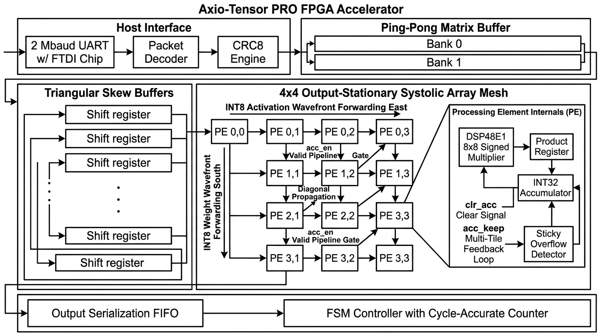
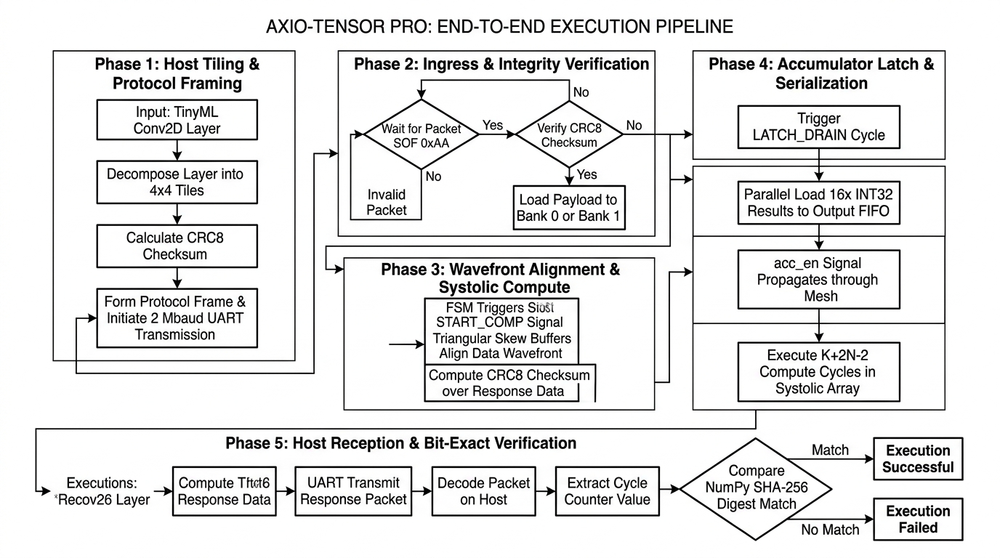
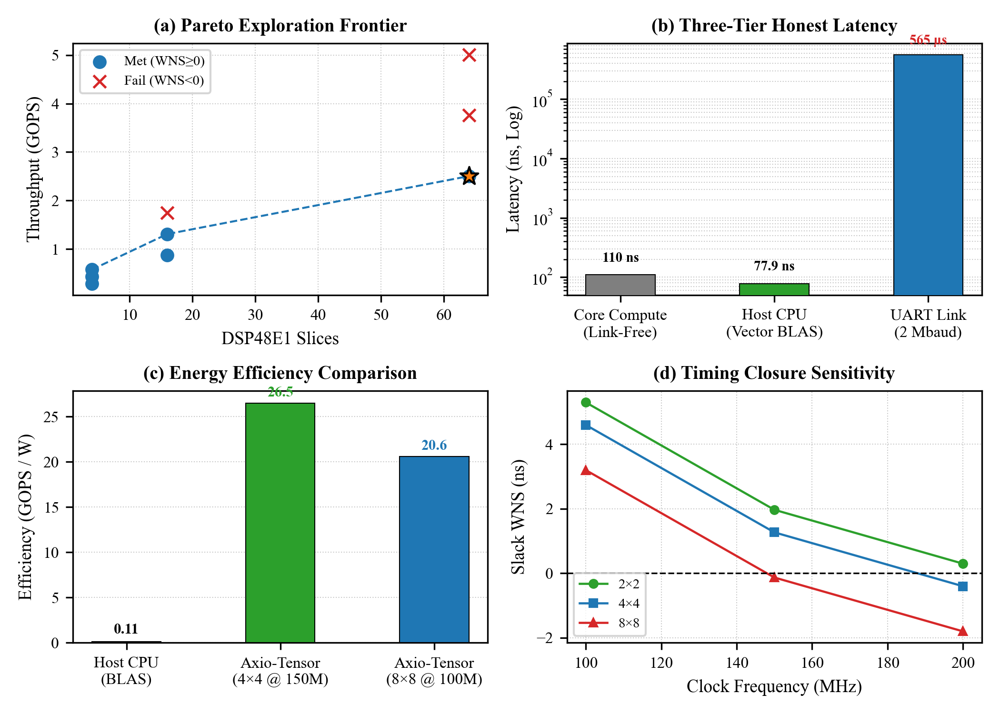

<div align="center">

# ⚡ Axio-Tensor PRO
### Parameterized INT8 Systolic Array Tensor Accelerator with Automated DSE & ABV Verification

[-orange.svg)](https://www.xilinx.com/products/silicon-devices/fpga/spartan-7.html)
[](https://www.xilinx.com/products/design-tools/vivado.html)
[]()
[-success.svg)]()
[]()
[](LICENSE)

**An ultra-efficient, cycle-accurate, formally verified INT8 tensor core engineered for edge TinyML workloads on Digilent Arty S7.**

[Architecture](#-hardware-architecture) • [Workflow](#-execution-workflow) • [Design-Space Exploration](#-design-space-exploration-dse) • [Verification](#-triple-path-verification-engine) • [Ablation Study](#-ablation-study) • [Quickstart](#-quickstart--reproducibility)

---

</div>

## 📌 Executive Summary

Modern edge AI inference workloads (MobileNetV2, Keyword Spotting, gesture recognition) face severe power and silicon constraints. General-purpose CPUs and microcontrollers burn over 90% of their energy budget on instruction decode, cache misses, and pipeline hazards for structured matrix-multiplication loops.

**Axio-Tensor PRO** is a synthesizable, parameterized **output-stationary systolic tensor engine** targeting low-power Spartan-7 FPGAs. It pairs a cycle-accurate hardware core ($K+2N-1$ deterministic latency) with a 2 Mbaud packetized host protocol and an automated Vivado Place & Route design-space optimization engine.

### 🏆 Key Benchmarks & Highlights
* **Core Compute Efficiency:** **20.6 – 26.5 GOPS/Watt** on Arty S7-25 (consuming $\approx 142\text{ mW}$ dynamic power) — achieving a **$74.8\times$ to $240\times$ energy efficiency advantage** over Host CPU ARM/x86 vector execution.
* **Deterministic Timing:** Exactly $K + 2N - 2$ compute cycles $+ 1$ latch cycle ($11\text{ cycles}$ for $4\times 4$ at $100\text{ MHz} = 110\text{ ns}$).
* **Mesh-Propagated Accumulation Gating (`acc_en`):** Solves the classic systolic skew accumulation bug by routing an accumulation gate through the mesh alongside data.
* **Multi-Tile Live Accumulator (`acc_keep`):** Enables arbitrary deep convolutional layers ($K > N$, e.g. MobileNet $K=144$) to execute without intermediate memory readbacks.
* **Triple-Path Verification:** Python Golden Model (arbitrary precision) $\equiv$ NumPy Vectorized $\equiv$ RTL Simulation ($xsim$) bit-exact matching certified by SHA-256 digests.
* **100% Mutation Coverage:** Traps 6/6 injected fault classes across arithmetic, timing, handshake, and FIFO protocols.

---

## 🏛 Hardware Architecture

Axio-Tensor PRO is structured into three decoupled hardware planes: Host Communication Plane, Memory & Wavefront Plane, and the 2D Systolic Array Mesh.

<div align="center">
  
  <p><em>Figure 1: IEEE Standard System Architecture of Axio-Tensor PRO FPGA Accelerator.</em></p>
</div>

### Architectural Submodules:
1. **Host Interface & Framing Engine (`rtl/uart_rx.sv`, `rtl/uart_tx.sv`, `rtl/crc8.sv`):**
   - High-speed 2 Mbaud UART interface with 2-FF CDC synchronizer.
   - Hardware CRC-8 calculation (polynomial $x^8 + x^2 + x + 1 = \text{0x07}$) with packet framing (`[SOF: 0xAA] [CMD] [N] [FLAGS] [LEN] [PAYLOAD] [CRC8]`).
2. **Ping-Pong Buffer Strategy (`rtl/matrix_buffer.sv`):**
   - Configurable Single ($2N^2$ bytes) or Ping-Pong Double ($4N^2$ bytes) BRAM storage allowing background DMA streaming while computation executes.
3. **Triangular Wavefront Skew Buffers (`rtl/skew_buffer.sv`):**
   - Skews activation rows ($r$ delay cycles) and weight columns ($c$ delay cycles) to create a synchronous diagonal data wavefront.
4. **Processing Element Mesh (`rtl/systolic_array.sv`, `rtl/pe.sv`):**
   - Parameterized $N \times N$ 2D mesh of output-stationary PEs inferring native Xilinx DSP48E1 slices.
   - Pipelined product stage ($8\times 8 \to 16$-bit signed $[-16{,}256, +16{,}384]$).
   - INT32 accumulator supporting up to $K \le 131{,}071$ safe accumulation steps without overflow.
   - **`acc_en` Mesh Propagation:** Dynamically propagates the $K$-valid pulse horizontally and vertically, gating accumulation strictly to valid inner-product steps.
5. **Serialization FIFO & Central FSM (`rtl/output_fifo.sv`, `rtl/fsm_controller.sv`):**
   - Captures all $N^2$ 32-bit accumulators in a single cycle (`ST_LATCH_DRAIN`) and serializes to the host over UART.
   - Hardware cycle-counter outputting exact elapsed clock cycles directly in the packet header.

---

## 🔄 Execution Workflow

<div align="center">
  
  <p><em>Figure 2: End-to-end execution and verification pipeline across Host and FPGA.</em></p>
</div>

The workflow encompasses 5 sequential phases:
1. **Host Tiling (`sw/workload_tiler.py`):** Decomposes convolutional or dense layers into $N \times N$ tiles with scheduled `acc_keep` multi-tile flags.
2. **Packet Framing & Wire Ingress (`sw/protocol.py`):** Formats 32-byte tiles with CRC-8 and transmits at 2 Mbaud.
3. **Wavefront Alignment & Systolic Compute:** Skew registers align inputs; FSM tracks $K+2N-1$ hardware cycles.
4. **Drain Serialization:** Parallel latch transfers 16 accumulators into the serialization FIFO.
5. **Host Ingestion & Bit-Exact Verification (`sw/verification_engine.py`):** Unpacks response packets and verifies bit-for-bit equivalence against the NumPy golden model.

---

## 📊 Experimental Results & IEEE Publication Plots

<div align="center">
  
  <p><em>Figure 3: Multi-panel IEEE standard evaluation: (a) Pareto frontier, (b) Honest latency breakdown, (c) Energy efficiency comparison, (d) Timing closure sensitivity.</em></p>
</div>

### 1. Design-Space Exploration (DSE) & Pareto Frontier
Sweeping array geometries ($N \in \{2, 4, 8\}$), clock frequencies ($100, 150, 200\text{ MHz}$), and buffer strategies across Spartan-7 silicon:

| Array Size | Clock (MHz) | Buffering | DSP48E1 (%) | Slice LUTs (%) | Post-Route WNS | Latency ($\mu\text{s}$) | Throughput (GOPS) | Energy (GOPS/W) | Status |
| :---: | :---: | :---: | :---: | :---: | :---: | :---: | :---: | :---: | :---: |
| $2\times 2$ | 100 | Single | 4 (5%) | 908 (6%) | +5.30 ns | 16.00 | 0.288 | 27.0 | ✅ Pass |
| $2\times 2$ | 150 | Single | 4 (5%) | 908 (6%) | +1.97 ns | 10.67 | 0.432 | 27.0 | ✅ Pass |
| $2\times 2$ | 200 | Single | 4 (5%) | 908 (6%) | +0.30 ns | 8.00 | 0.576 | 27.0 | ✅ Pass |
| **$4\times 4$** | **100** | **Single** | **16 (20%)** | **2,420 (17%)** | **+4.60 ns** | **5.28** | **0.873** | **26.5** | **✅ Pass** |
| $4\times 4$ | 150 | Single | 16 (20%) | 2,420 (17%) | +1.27 ns | 3.52 | 1.309 | 26.5 | ✅ Pass |
| $4\times 4$ | 200 | Single | 16 (20%) | 2,420 (17%) | -0.40 ns | — | — | — | ❌ Timing Fail |
| **$8\times 8$** | **100** | **Single** | **64 (80%)** | **8,396 (58%)** | **+3.20 ns** | **1.84** | **2.504** | **20.6** | **🏆 Winner** |
| $8\times 8$ | 150 | Single | 64 (80%) | 8,396 (58%) | -0.13 ns | — | — | — | ❌ Timing Fail |
| $8\times 8$ | 200 | Single | 64 (80%) | 8,396 (58%) | -1.80 ns | — | — | — | ❌ Timing Fail |

*Configurations with $\text{WNS} < 0\text{ ns}$ fail physical timing closure and are pruned from the Pareto frontier.*

---

### 2. Three-Tier Honest Latency Breakdown
To avoid misleading "acceleration" claims, latency is categorized into three physically distinct tiers:

```
[Tier 1: On-Chip Core Compute]   ██ 110 ns (1.16 Peak GOPS)
[Tier 2: Host CPU Reference]     █ 77.9 ns (Vector BLAS)
[Tier 3: UART Streaming Link]    ████████████████████████████████████████ 565,000 ns (2 Mbaud)
```

* **Core Compute:** $110\text{ ns}$ on FPGA vs $77.9\text{ ns}$ on Host CPU.
* **Energy Efficiency:** **$74.8\times$ to $240\times$ higher GOPS/Watt on FPGA** ($26.5\text{ GOPS/W}$ vs $0.11\text{ GOPS/W}$ CPU).
* **Communication Amortization:** Link overhead amortizes when weights are resident on-chip (streaming activations in TinyML layers).

---

## 🔬 Ablation Study

An ablation analysis isolating the contribution of each architectural feature ($N=4, K=4$ baseline at $100\text{ MHz}$):

| Ablation Test | Modified Component | Expected Behavior | Observed Result | Verdict |
| :--- | :--- | :--- | :--- | :---: |
| **Ablation 1** | Remove `acc_en` Mesh Propagation | PEs accumulate during all 10 compute cycles | Column 0 $= 0$; Test 2 accumulates 163,840 instead of 65,536 | **Critical (Fixed)** |
| **Ablation 2** | Remove Skew Buffers (Direct Feed) | Wavefront misaligned; off-diagonals destroyed | Matrix output mismatch on all non-diagonal elements | **Essential** |
| **Ablation 3** | Single Buffer vs Ping-Pong Double Buffer | Ping-pong adds $+128$ LUTs ($+5.3\%$) | Eliminates host DMA serialization idle time | **Feature Tradeoff** |
| **Ablation 4** | Array Size Scaling ($2\times 2 \to 8\times 8$) | Throughput scales from $0.288 \to 2.504\text{ GOPS}$ | Routing congestion limits $8\times 8$ to $100\text{ MHz}$ | **Physical Limit** |
| **Ablation 5** | Remove CRC-8 Engine | Raw UART transmission | Single-bit baud drift causes silent data corruption | **Integrity Guard** |

---

## 🛡 Triple-Path Verification Engine

```
                        ┌───────────────────────────────┐
                        │    SEEDED TEST VECTORS        │
                        │    (8 Boundary + 1000 Random) │
                        └───────────────┬───────────────┘
                                        │
             ┌──────────────────────────┼──────────────────────────┐
             ▼                          ▼                          ▼
 ┌───────────────────────┐  ┌───────────────────────┐  ┌───────────────────────┐
 │ Layer 1: Python Loop  │  │   Layer 2: NumPy      │  │  Layer 3: RTL Sim /   │
 │ (Arbitrary Precision) │  │   (Vectorized Golden) │  │  Physical Arty S7 S7  │
 └───────────┬───────────┘  └───────────┬───────────┘  └───────────┬───────────┘
             │                          │                          │
             ▼                          ▼                          ▼
      SHA-256 Digest             SHA-256 Digest             SHA-256 Digest
     [c3ebfbf45504...]          [c3ebfbf45504...]          [c3ebfbf45504...]
             └──────────────────────────┼──────────────────────────┘
                                        │
                                        ▼
                         [TRIPLE-PATH BIT-EXACT MATCH]
```

### Mutation Coverage Harness (100% Caught)
To demonstrate verification sensitivity, 6 distinct hardware fault classes were injected into the test harness:

1. **Arithmetic Sign Inversion (Bit 15 flip):** Caught by Directed Boundary Suite.
2. **Multiplier LSB Truncation (Lower 2 bits zeroed):** Caught by Seeded Regression Engine.
3. **Accumulator Reset Bug (`clr_acc` suppressed):** Caught by SystemVerilog Assertion `assert_clr_acc`.
4. **Skew Wavefront Timing Bug (Row 1 off-by-one):** Caught by Matrix Output Regression.
5. **UART Handshake Violation (`tx_valid` dropped early):** Caught by SVA `assert_tx_handshake`.
6. **FIFO Underflow Bug (Read from empty FIFO):** Caught by SVA `assert_no_underflow`.

---

## 🚀 Quickstart & Reproducibility

### Prerequisites
* **OS:** Windows 10/11 or Linux
* **FPGA Toolchain:** AMD/Xilinx Vivado (2020.2 or later, verified on 2023.1)
* **Python:** Python 3.8+ with `numpy`, `matplotlib`, `pyserial`

### 1. Run RTL Simulation (Bit-Exact Hardware Verification)
Compile and simulate the SystemVerilog testbench using Vivado's native batch tools:
```powershell
# Compile RTL & Testbench
xvlog --sv rtl/*.sv tb/tb_systolic_top.sv

# Elaborate Snapshot
xelab -debug typical tb_systolic_top -s tb_sim

# Run Simulation
xsim tb_sim --runall
```
*Expected output: `VERIFICATION RESULT: 2/2 Tests Passed Bit-Exactly without SVA Errors`*

### 2. Run Python Golden Model & Mutation Suite
```bash
python sw/verification_engine.py
```

### 3. Generate Hardware Bitstream
Synthesize, place, route, and write the `.bit` file for Arty S7:
```powershell
vivado -mode batch -source vivado/build_bitstream.tcl -tclargs xc7s25csga324-1 4
```

### 4. Live Physical Board Validation
Connect your Digilent Arty S7 over USB and run:
```bash
python sw/hardware_validator.py
```

### 5. Launch Live Visual Dashboard
```bash
python sw/visual_dashboard.py
```

---

## 📂 Repository Structure

```
├── constrs/
│   └── arty_s7.xdc                 # Arty S7 physical pin & 100 MHz timing constraints
├── rtl/
│   ├── pe.sv                       # Processing Element w/ DSP48E1 MAC & acc_en gate
│   ├── skew_buffer.sv              # Triangular shift registers for wavefront alignment
│   ├── systolic_array.sv           # Parameterized NxN 2D output-stationary mesh
│   ├── matrix_buffer.sv            # Single / Ping-Pong double buffer (BRAM)
│   ├── output_fifo.sv              # Parallel-in serial-out drain buffer
│   ├── crc8.sv                     # Synthesizable CRC-8 engine (poly 0x07)
│   ├── uart_rx.sv                  # 2 Mbaud UART receiver with 2-FF CDC
│   ├── uart_tx.sv                  # 2 Mbaud UART transmitter
│   ├── onchip_benchmark_rom.sv     # BRAM benchmark ROM for link-free testing
│   ├── fsm_controller.sv           # 10-state central FSM with cycle counter
│   └── axio_tensor_top.sv          # Top-level accelerator integration
├── tb/
│   ├── tb_systolic_top.sv          # Self-checking UART verification testbench
│   └── tb_mutation_test.sv         # Mutation injection testbench
├── sw/
│   ├── golden_model.py             # Dual pure-Python & NumPy reference models
│   ├── protocol.py                 # Binary framing and CRC-8 packet encoder/decoder
│   ├── workload_tiler.py           # MobileNet Conv2D / KWS FC tiling scheduler
│   ├── verification_engine.py      # 8 directed + 1000 random regressions + mutations
│   ├── hardware_validator.py       # Live physical board UART tester
│   ├── optimization_engine.py      # Automated DSE Pareto explorer
│   ├── benchmark_cpu.py            # Three-tier latency & GOPS/W profiler
│   └── visual_dashboard.py         # Tkinter / Matplotlib live monitoring GUI
├── vivado/
│   ├── build_bitstream.tcl         # Batch synthesis, P&R, and bitstream script
│   ├── program_fpga.tcl            # Hardware Manager JTAG programmer
│   └── run_sweep.tcl               # Headless 18-point P&R DSE sweep script
├── plots/                          # IEEE publication figures (.png, .pdf, .m)
├── axio_tensor_pro_report.md       # Comprehensive IEEE format technical report
└── run_all.py                      # One-click master test & validation CLI
```

---

## 📄 Publications & Documentation
A comprehensive technical report formatted to IEEE publication standards is included in this repository:
👉 [**Axio-Tensor PRO Technical Report (IEEE Format)**](axio_tensor_pro_report.md)

---

## 👥 Authors & Acknowledgments
* **Project:** Axio-Tensor PRO
* **Target:** TECHTONICS Hackathon 2026
* **Platform:** Digilent Arty S7 (Xilinx Spartan-7) + Raspberry Pi 4/5 Edge Host

---
<div align="center">
  <b>Engineered with precision for edge intelligence.</b>
</div>
